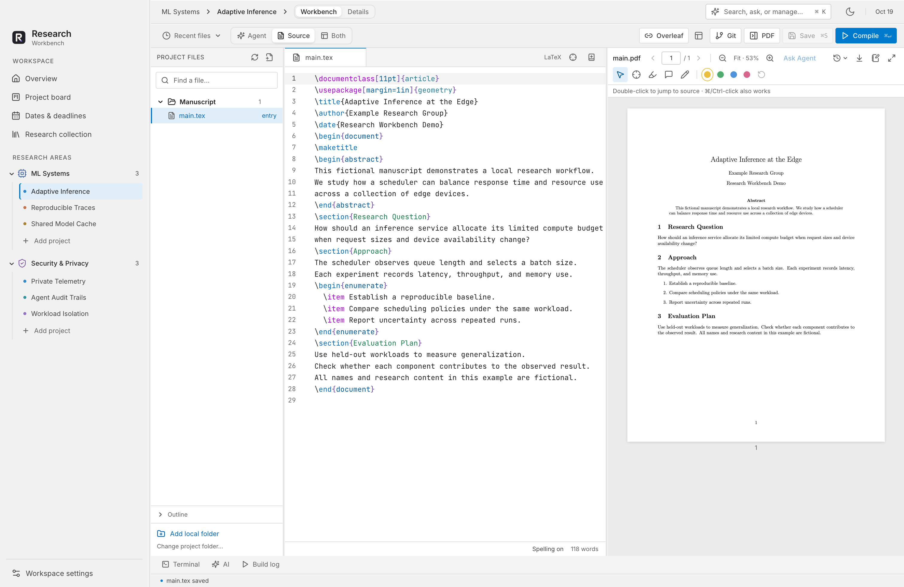
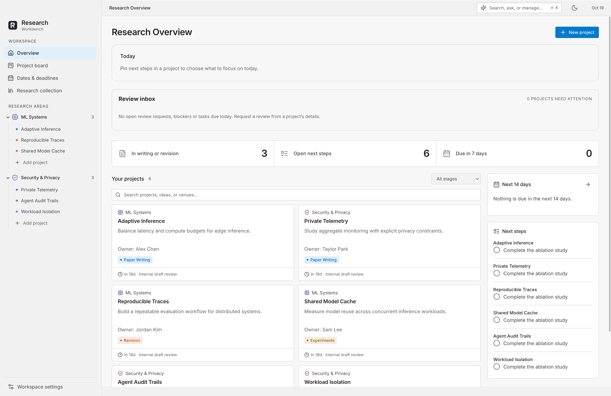
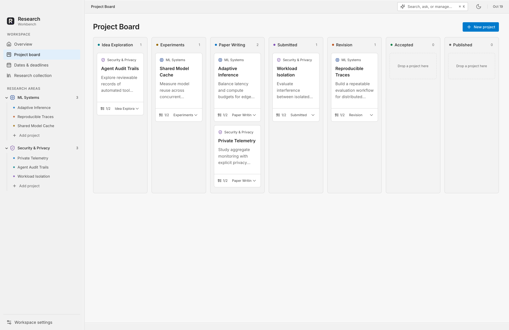
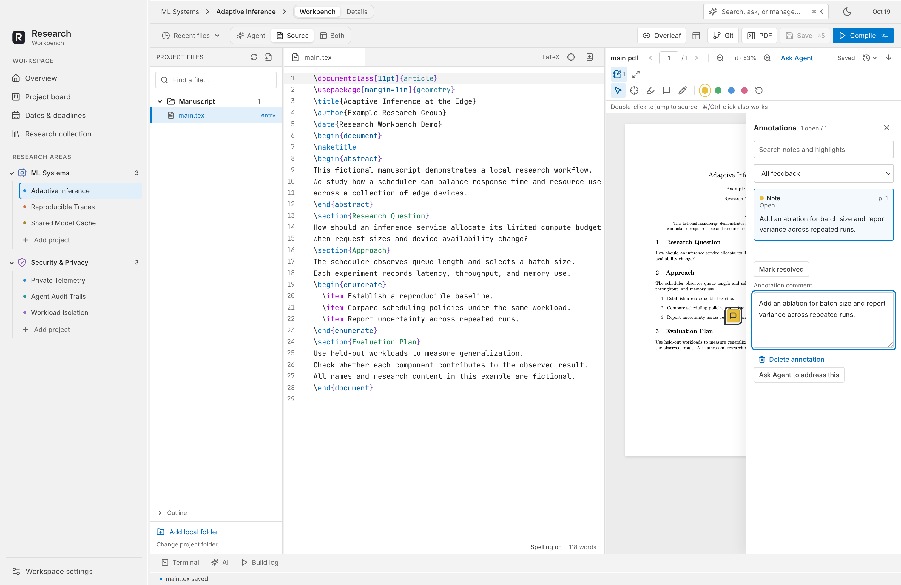
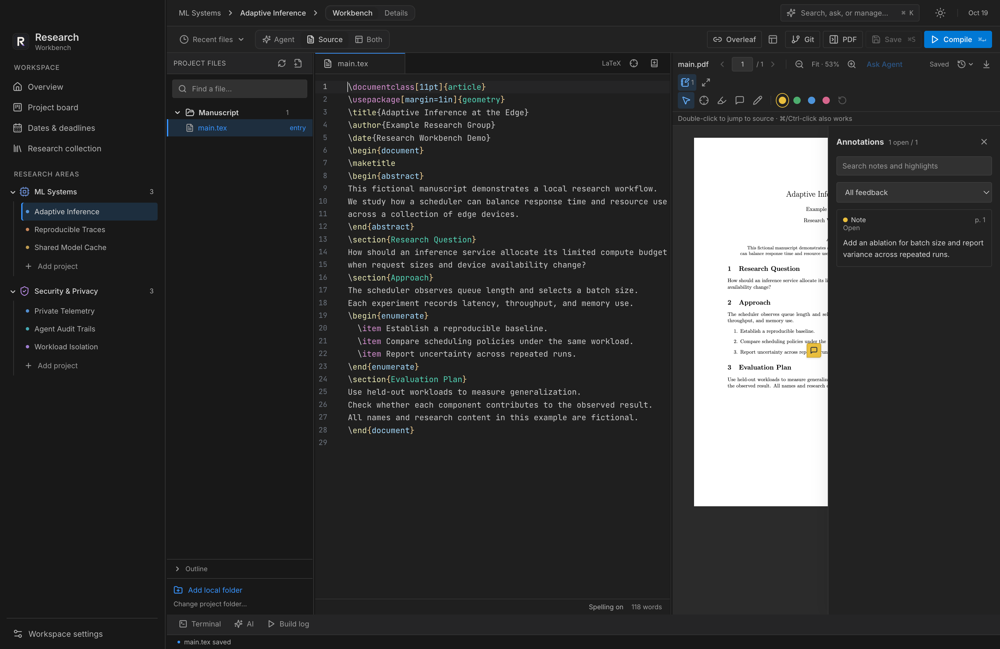

# Research Workbench

**All your research projects, an Agent that can work on them, and your manuscript workflow in one Mac app.**

Research Workbench brings project management, LaTeX, PDF feedback, and Overleaf collaboration into a local workspace for researchers and principal investigators. Project files stay in ordinary folders on your computer.

[Install](#one-line-installation) · [Features](#feature-reference) · [中文使用指南](docs/USER_GUIDE.zh-CN.md) · [Downloads](https://github.com/naisslab/ResearchWorkbench/releases) · [Overleaf Collaboration](docs/overleaf.md) · [Contributing](CONTRIBUTING.md)



*The screenshots show the actual application with fictional projects, collaborators, and manuscript content.*

## One-Line Installation

On an Apple silicon Mac running macOS 13 or later, with [GitHub CLI](https://cli.github.com) installed and signed in to an account that can access this private repository:

```sh
bash -c 'set -e; installer=$(gh api -H "Accept: application/vnd.github.raw+json" "repos/naisslab/ResearchWorkbench/contents/scripts/install-macos.sh?ref=main"); bash -c "$installer"'
```

The [installer](scripts/install-macos.sh) downloads the pinned 0.1.0 preview, verifies its SHA-256 checksum and app identity, and installs it in `~/Applications`. It requires no source checkout, Node.js, Xcode, or administrator access. Existing installations are left unchanged; use the [DMG](#download-and-install) for an upgrade.

**Prefer to ask Claude Code or Codex?** Copy this request into your agent:

```text
Install Research Workbench on my Mac from the private GitHub repository naisslab/ResearchWorkbench. Use gh to read README.md and follow its One-Line Installation instructions. Help set up GitHub CLI if needed, let me complete any required login, and report the installed app path and any first-launch limitation.
```

This development preview is unsigned and not notarized. macOS may block first launch; the installer preserves Gatekeeper and quarantine settings. Open the installed app from Finder. See [Download and Install](#download-and-install) for manual installation and optional TeX setup.

## All Your Research Projects in One Place

Keep every project in one workspace, even when its files live in different local folders or Overleaf repositories. Group projects by research area, assign owners, and track each manuscript from the first idea to publication. The overview brings together next steps, upcoming dates, and the PI review inbox.

Switch between projects while keeping editor drafts, PDF reading positions, layouts, and conversations with their project. An Agent can continue working while you visit another project. Search across project files, PDF text, notes, feedback, and conversations from `⌘K`, then open a result in its original context.

For a research group, assign tasks and due dates, request a review of a specific manuscript revision, and record the resulting decision. Project metadata, calendars, and submission bundles can be exported for collaborators.

## Agent-Native Research Workflows

The Agent can use the workbench's research tools directly: read project state, edit manuscript files, compile LaTeX, inspect submission problems, find references, and respond to PDF feedback. Tool results update the same project data, build log, and PDF preview used by the interface.

### From a Request to a Research Action

| Ask the Agent To… | What It Can Do |
| --- | --- |
| “Show the next steps across my writing projects.” | Read workspace state and search across projects, with links back to files and PDFs. |
| “Add an ablation task and move this project to revision.” | Update tasks, notes, milestones, and project stages through the workspace save flow, with undo. |
| “Fix the compile errors and rebuild the paper.” | Edit source files, invoke manuscript compilation, inspect structured file/line problems, and refresh the PDF preview. |
| “Find this paper by DOI and add its citation.” | Look up DOI, arXiv, or title metadata, retrieve BibTeX, and edit the manuscript and bibliography. |
| “Address the open comments on this PDF.” | Read annotations, use available SyncTeX source locations, edit the manuscript, and record a reply on the feedback. You decide when a comment is resolved. |
| “Check the manuscript before submission.” | Run the workbench's submission and reference checks against files and the compiled PDF. Checks help identify issues; they do not certify venue compliance. |

### Control the Work as It Runs

**Steer or queue.** Send a correction to the active task with **Steer**, or queue follow-up requests with their own model settings, attachments, and skills. Reorder, pause, or resume queued work. Stop interrupts the active task and pauses the queue.

**Use skills and connected tools.** Select installed research and writing skills from the composer or `/` menu. Configure MCP connections for HTTP or local tools, including OAuth where supported. Built-in controls also expose code review and Cached, Live, or Off web search. Availability depends on the connected service, model, account, and policy.

**Keep the research context.** Attach the current file, selected text, PDF excerpts, or images. Maintain separate conversations per project, search their history, or fork a conversation to explore another approach. Forks share the project files, so they are not isolated copies of the manuscript.

**Review the result.** Inspect command output and file diffs, compare before/after manuscript PDFs when snapshots are available, and compile to verify a run against its recorded source state. Revert selected file changes when later edits do not conflict. Choose the permission mode and handle access requests in the app.

Local project management, editing, and PDF reading work without an AI login. **Continue with ChatGPT** connects a supported account through [Sign in with ChatGPT](https://developers.openai.com/siwc/token-sharing-open-source/). Files and tool output included in AI requests are sent to OpenAI. See [Security and Privacy](SECURITY.md) and the [Agent guide](docs/USER_GUIDE.zh-CN.md#chatgpt-agent).

## From Manuscript to Reviewed PDF

Write LaTeX, compile locally, navigate between source and PDF, and annotate the result in one window. Choose **Source**, **Agent**, or **Both** to fit the current task. Reference lookup, citation checks, revision comparisons, and submission checks support the same manuscript workflow.

Overleaf collaborators can keep using their existing editor while you review source changes locally, compile a candidate, and explicitly publish the reviewed source. Complete backups preserve project files, PDF feedback, and conversations for recovery or migration.

## Feature Reference

### Organize the Research Portfolio

| Your Goal | What You Get |
| --- | --- |
| Keep all projects together | Research areas, project owners, notes, and drag-and-drop ordering across local folders and Overleaf repositories. |
| See what needs attention | A stage board, next steps, task assignees, due dates, conference dates, milestones, and local reminders. |
| Coordinate PI feedback | A review inbox, requests tied to manuscript revisions, reviewed-commit tracking, and decision records. |
| Find prior work | Cross-project search over files, PDF text, notes, annotations, and saved conversations, with links back to the source. |

### Work With an Agent

| Your Goal | What You Get |
| --- | --- |
| Act on research requests | Project updates, multi-file edits, manuscript compilation, reference lookup, submission checks, and replies to PDF feedback. |
| Guide a longer task | Live steering, queued follow-ups, pause/resume controls, and per-request model settings, skills, and attachments. |
| Extend the available tools | Installed skills, MCP connections, web-search controls, and built-in code review. |
| Inspect and keep control | Permission modes, access approvals, execution logs, file diffs, manuscript PDF comparisons, and selective revert. |
| Continue an investigation | Separate project conversations, history search, conversation forks, and file, selection, PDF, or image context. |

See [Agent-Native Research Workflows](#agent-native-research-workflows) for concrete requests and how the Agent carries them out. AI use is optional; connected capabilities depend on the account and service.

### Write, Review, and Collaborate

| Your Goal | What You Get |
| --- | --- |
| Write and compile LaTeX | Multi-file editing, highlighting, outline, word count, citation/label completion, and pdfLaTeX, XeLaTeX, or LuaLaTeX builds. |
| Move between source and paper | Bidirectional SyncTeX navigation, clickable build problems, resizable panes, and Source, Agent, or Both layouts. |
| Review the PDF | Highlights, notes, ink, annotation search, open/resolved feedback, version snapshots, and standard PDF annotation export. |
| Prepare a submission | DOI/arXiv/title lookup, BibTeX insertion, citation checks, revision comparisons, and submission checks. |
| Work with coauthors | Overleaf Git synchronization, incoming-change review, candidate compilation, and explicit publication of reviewed source. |
| Use your development tools | Git status and diffs, local terminals, and SSH terminals. |

### Preserve Work Between Sessions

| Your Goal | What You Get |
| --- | --- |
| Recover unfinished work | Unsaved-draft recovery and project-specific editor, PDF, layout, and conversation state. |
| Share or move a project | Portable metadata, calendar export, and submission bundles. |
| Back up the workspace | Complete backup and restore with integrity checks, including selected project files, PDF feedback, and conversations. |
| Fit your desktop workflow | Light/dark/system themes, keyboard commands, bundled fonts, and on-device dictation on supported Macs. |

## Screenshots

### Research Overview and Project Board

See the research portfolio, next steps, and project progress from one workspace. Group projects by research area and move them through the manuscript lifecycle.





### Write and Review in the Same Window

Edit source beside the compiled manuscript. Use PDF feedback to record changes and track which comments remain open. Annotations are stored locally and can be exported in a PDF copy.



The editor, PDF workspace, and application controls also support a dark theme.



### Collaborate With Overleaf

Keep collaborators working in Overleaf while using local editing, PDF review, and project management. **Connect Overleaf** uses Git source synchronization. Follow the [Overleaf guide](docs/overleaf.md) for token setup, review, conflict resolution, compilation, and publication.

A downloaded Overleaf source ZIP can also be extracted and opened as a local project. ZIP import does not synchronize subsequent changes. Overleaf comment threads and live editing state are not included in source synchronization. Local TeX packages, fonts, and build settings can produce different output.

## Download and Install

**Version 0.1.0 is a development preview.** The available DMG targets Apple silicon (M1 or newer) and macOS 13 or later. It has no Developer ID signature or Apple notarization; macOS may block opening it. It is intended for internal testing. A signed and notarized installer is still pending.

1. Open the [0.1.0 development preview](https://github.com/naisslab/ResearchWorkbench/releases/tag/preview-0.1.0).
2. Download `Research-Workbench-0.1.0-arm64.dmg` and, optionally, `SHA256SUMS-arm64.txt` to verify the download.
3. Open the DMG and copy **Research Workbench** into Applications.
4. Launch the app and choose **Open a folder**, **Connect Overleaf**, or **Try an example**.

The private repository and release require a GitHub account with access. End users do not need Node.js or Xcode. An Intel build is configured but is not included in this preview. Windows and Linux packages are not supported yet.

LaTeX compilation requires a local TeX distribution with `latexmk` and the selected engine. [MacTeX](https://www.tug.org/mactex/) is one option. Project organization and PDF reading work without TeX. On-device dictation requires macOS 26 or later and a supported speech model; models may download on first use.

## First Project

1. Choose **Open a folder**, **Connect Overleaf**, or **Try an example** on the welcome screen.
2. In **Workbench setup**, choose the manuscript entry file and TeX engine.
3. Open the workbench, edit a file, and select **Compile**. Build problems link back to source lines.
4. Add tasks, milestones, and review requests. Use PDF annotations to record feedback.
5. Create a **Complete backup** in Settings before moving to another computer.

| Shortcut | Action |
| --- | --- |
| `⌘K` | Open workspace search and conversation |
| `⇧⌘P` | Open command search |
| `⌘S` | Save the current file or PDF feedback |
| `⌘↵` | Compile the manuscript |
| `⇧⌘J` | Locate the source position in the PDF |

## Build From Source

Development requires Node.js 24 LTS, npm 11+, and Xcode 26+ selected with `xcode-select`. Xcode builds the native dictation helper.

```sh
git clone https://github.com/naisslab/ResearchWorkbench.git
cd ResearchWorkbench
npm ci
npm run dev
```

Create a local development app or installer:

```sh
npm run package  # App directory
npm run dist     # DMG installer
npm run check:release -- --artifacts --development
```

On Apple silicon, the app appears at `release/mac-arm64/Research Workbench.app`. Intel builds use `release/mac/Research Workbench.app`. These commands create unsigned artifacts and do not upload releases. See the [release guide](docs/release.md) for signing, notarization, and distribution checks.

## Verification

```sh
npm test
npm run build
npm run test:e2e
npm run test:release-ui
npm run test:portfolio-ui
npm run test:packaged-ui
```

GUI checks require a macOS desktop session; compilation checks also require TeX tools. Tests use isolated application data. [Contributing](CONTRIBUTING.md) lists focused suites for AI, writing, recovery, and other workflows.

To regenerate the README images with fictional data:

```sh
npm run build
node scripts/readme-screenshots.mjs
```

Images are written to `output/playwright/readme-*.png`. Review them before copying the selected files to `docs/images/`.

## Data and Release Status

New installations start with an empty workspace. Existing workspaces retain their projects and notes. The historical personal catalog is excluded from packaged apps and requires an explicit development import in the source checkout.

The app stores workspace metadata, drafts, PDF feedback, and conversations under its application support directory. Settings shows the exact path. Removing a project from the workspace does not delete its source folder.

Workspace JSON export contains metadata and paths. **Complete backup** can also include linked project folders, PDF snapshots, annotations, and conversations. Authentication credentials are excluded. Backups may contain private research.

This preview does not include automatic background updates. Install newer releases manually and make a complete backup before upgrading. See the [changelog](CHANGELOG.md) and [architecture and roadmap](docs/architecture-and-roadmap.md) for implementation notes and planned work.

## License

Research Workbench uses the [MIT license](LICENSE). Dependencies and bundled resources retain their own licenses; see [Third-Party Notices](THIRD_PARTY_NOTICES.md).
