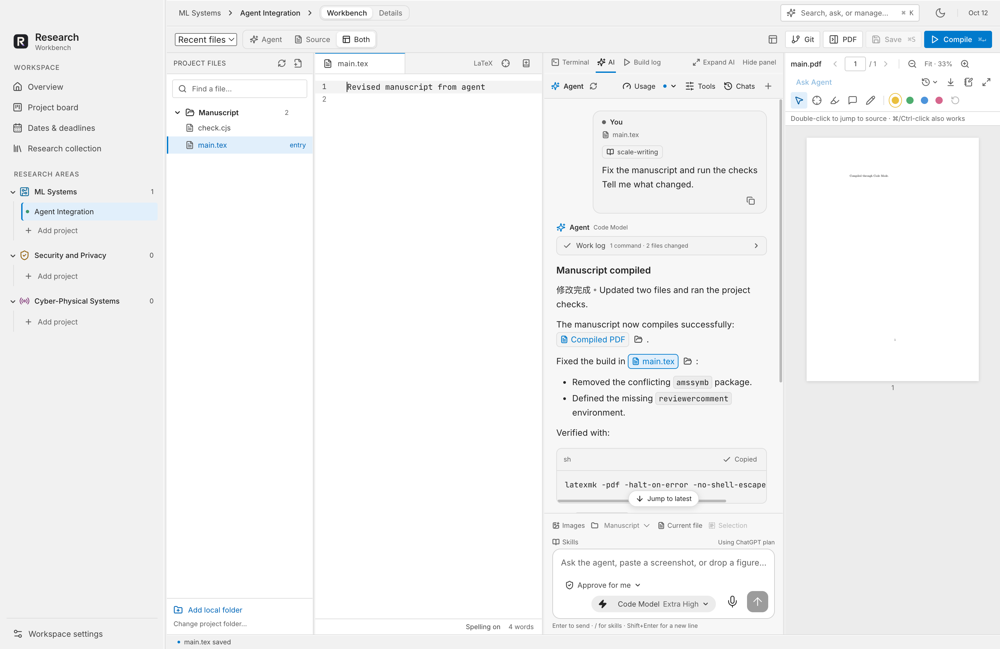
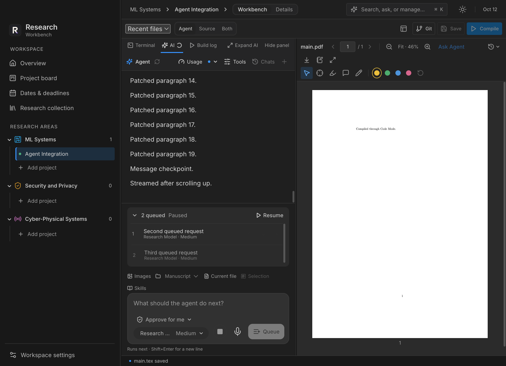
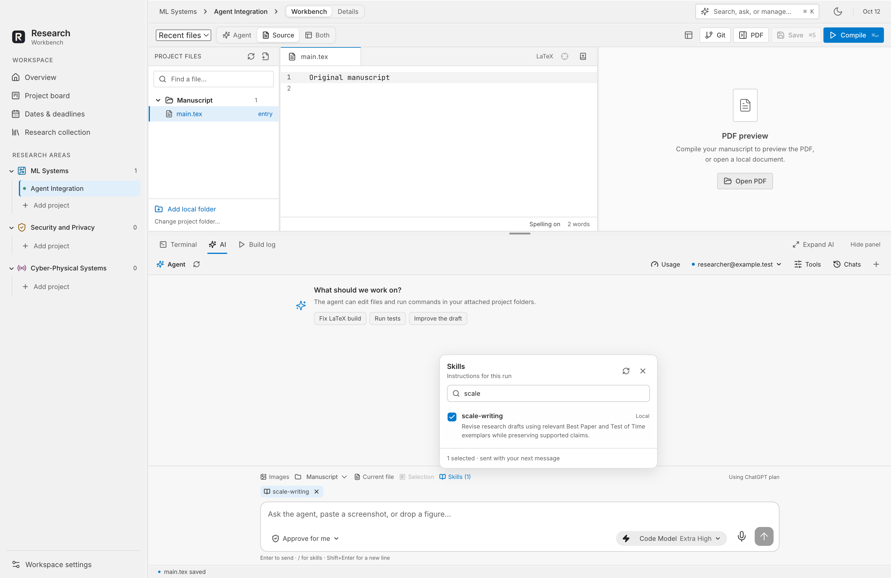
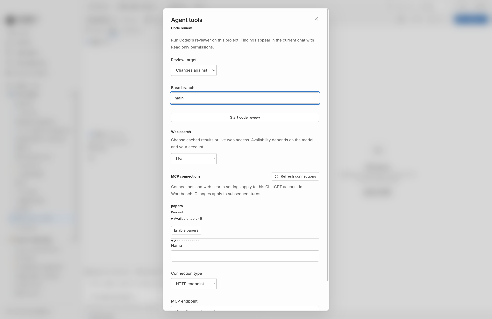
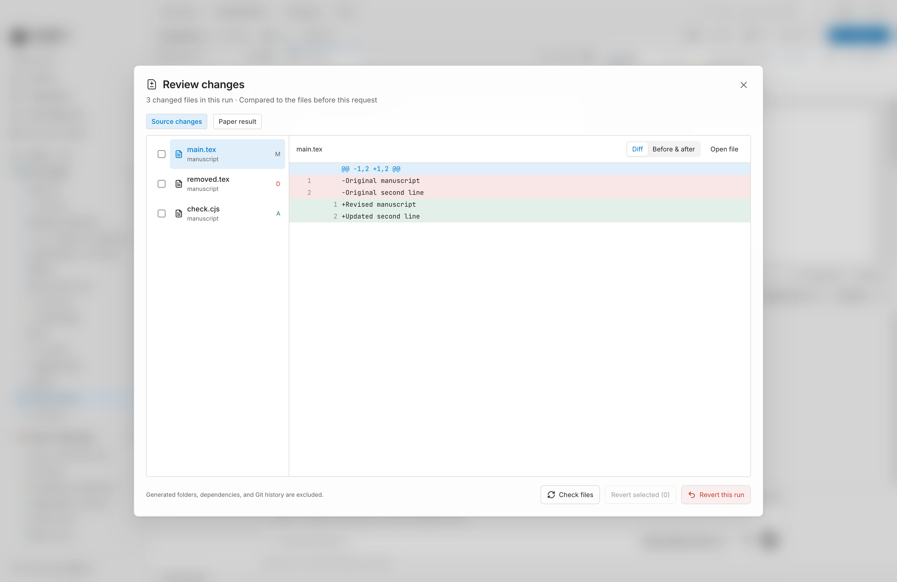
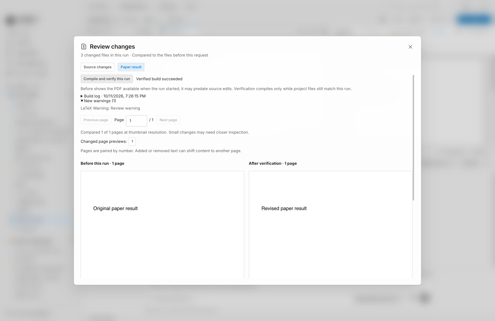

# Research Workbench

**All your research projects, an Agent that works with them, and your manuscript workflow in one Mac app.**

Research Workbench brings project management, AI assistance, LaTeX editing, and PDF review into a shared workspace for researchers and principal investigators. Keep your files in ordinary folders, connect an Overleaf project, and move between research, writing, and review without losing the context of each project.

[Install](#install) · [Projects](#keep-your-projects-together) · [Agent](#work-with-an-agent) · [Writing and Review](#write-review-and-collaborate) · [Updates](#update-or-reinstall) · [中文指南](docs/USER_GUIDE.zh-CN.md)


## Install

[**Download for macOS**](https://github.com/naisslab/ResearchWorkbench/releases) · [Release Notes](CHANGELOG.md)

Open the release DMG, drag **Research Workbench** into Applications, and launch it. Choose **Open a folder**, **Connect Overleaf**, or **Try an example** to get started.

> **Current release: 0.1.0 development preview.** The available installer is for Apple silicon and macOS 13 or later. It is unsigned and not notarized, so macOS may block first launch. A signed release is still pending. Intel packaging is configured, but no Intel installer is included in this preview. Windows and Linux are not supported yet.

### One-Line Installation

With [GitHub CLI](https://cli.github.com) installed and signed in (`gh auth login`), run:

```sh
bash -c 'set -e; installer=$(gh api -H "Accept: application/vnd.github.raw+json" "repos/naisslab/ResearchWorkbench/contents/scripts/install-macos.sh?ref=main"); bash -c "$installer" -- --preview'
```

The [installer](scripts/install-macos.sh) installs or updates the latest stable release. Until a stable release exists, `--preview` explicitly allows the unsigned 0.1.0 preview. New installations go into `~/Applications`; existing installations are updated in place. Downloaded apps are checked before installation. Users do not need Node.js, Xcode, or a signing certificate.

**To install with Claude Code or Codex**, paste this request into your agent:

```text
Install Research Workbench on my Mac from https://github.com/naisslab/ResearchWorkbench. Read its README and follow the installation instructions. Help set up GitHub CLI if needed, let me complete any required login, and report the installed app path and any first-launch limitation.
```

### Open Your First Project

1. **Bring your files.** Open a local folder, connect an Overleaf project, or try the included example.
2. **Set up the manuscript.** Select its main `.tex` file and TeX engine, then choose **Compile**.
3. **Choose how to work.** Use **Source** for editing, **Agent** for assisted work, or **Both** to see source, conversation, and PDF together.

Project management and PDF reading work without a TeX installation or AI login. Compiling LaTeX requires `latexmk` and your selected TeX engine; [MacTeX](https://www.tug.org/mactex/) is one option. Connect a supported ChatGPT account to use the Agent.

## Keep Your Projects Together

Bring projects from different local folders and Overleaf repositories into one research portfolio. Group them by research area, assign owners, and track progress from the first idea through experiments, writing, submission, revision, and publication.

The overview brings together tasks, upcoming dates, and the PI review inbox. Review requests can refer to a specific manuscript revision, so a decision stays connected to the version that was reviewed.


Switch projects while retaining editor drafts, PDF reading positions, layouts, and conversations. An Agent can keep working while you visit another project. Use `⌘K` to search files, PDF text, notes, feedback, and saved conversations across the workspace, then open a result at its source.

<details>
<summary>See the project board</summary>

Move projects between stages and keep the whole portfolio visible.


</details>

## Work With an Agent

The Agent can act on the same research workspace you use: edit files, compile the manuscript, inspect problems, find references, read PDF feedback, and update project information. Results appear in the editor, build log, PDF preview, and project views.



*Agent screenshots reuse existing UI captures with test conversations and illustrative model names. Available models depend on your account.*

### Turn a Request Into Work

| Try Asking… | The Agent Can… |
| --- | --- |
| “What needs attention across my writing projects?” | Read workspace state, search across projects, and link back to relevant files and PDFs. |
| “Add an ablation task and move this project to revision.” | Update tasks, notes, milestones, and project stages, with undo for workspace changes. |
| “Fix the compile errors and rebuild the paper.” | Edit source, compile through the workbench, inspect file-and-line problems, and refresh the PDF. |
| “Find this paper by DOI and add its citation.” | Retrieve reference metadata and BibTeX, then edit the bibliography and manuscript. |
| “Address the open comments on this PDF.” | Read feedback, use available source locations, make changes, and record a reply. You decide when a comment is resolved. |
| “Check the manuscript before submission.” | Run reference and submission checks against the files and compiled PDF. These checks help identify issues; they do not certify venue compliance. |

### Guide the Work

Use **Steer** to add direction to the active task, or **Queue next** to save a follow-up. Queued requests retain their model settings, attachments, and selected skills. Reorder, pause, or resume the queue as your priorities change.

Attach a file, selection, PDF excerpt, or image to a request. Each project can have separate conversations with searchable history. Fork a conversation to explore another approach; forks share the same project files.

<details>
<summary>See queued requests in dark mode</summary>



</details>

### Bring Your Skills and Tools

Select installed research or writing skills from the composer or `/` menu. Configure MCP connections for local tools or HTTP services, including OAuth where supported. The tools panel also provides code review and web-search controls.

<table>
<tr>
<th>Choose Skills for a Request</th>
<th>Connect Tools and Configure Reviews</th>
</tr>
<tr>
<td width="50%"><a href="docs/images/agent-skills.png"></a></td>
<td width="50%"><a href="docs/images/agent-tools.png"></a></td>
</tr>
</table>

### Review What Changed

Inspect execution logs and per-file diffs after a run. Revert selected changes when later edits do not conflict, or open a changed file to continue editing. Permission modes and access approvals let you control where the Agent can work.



**Paper result** compares the manuscript PDFs saved before and after a run, when snapshots are available. **Compile and verify this run** checks the build against that run's recorded source state.

<details>
<summary>See the before-and-after PDF review</summary>



</details>

AI is optional. ChatGPT model access and connected tools depend on your account and service availability. Files and tool output included in an AI request are sent to OpenAI. See [Security and Privacy](SECURITY.md) for details.

## Write, Review, and Collaborate

Edit multi-file LaTeX with syntax highlighting, outlines, word counts, and citation completion. Compile with pdfLaTeX, XeLaTeX, or LuaLaTeX. Click a build problem to jump to its source, or use SyncTeX to move between source and PDF.

Mark up the manuscript with highlights, notes, and ink. Search feedback, track open and resolved comments, revisit annotated versions, and export a PDF containing standard annotations.


**Keep working with your coauthors.** Connect Overleaf through Git, inspect incoming source changes, compile a review candidate, and explicitly publish the reviewed source. A source ZIP can also be opened as a local project. Git synchronization does not include Overleaf comment threads or live editing state, and local TeX settings can produce different output. See the [Overleaf guide](docs/overleaf.md).

## Feature Reference

| Area | Included Capabilities |
| --- | --- |
| Research portfolio | Research areas, owners, stage board, project notes, task assignees, milestones, conference dates, reminders, and PI review records. |
| Agent workflows | Workspace search and updates, file editing, compilation, references, PDF feedback, steering, queued requests, skills, MCP, and change review. |
| Manuscript preparation | LaTeX editing, three TeX engines, SyncTeX, BibTeX lookup, citation checks, revision comparisons, and submission checks. |
| Developer tools | Git status and diffs, local terminals, and SSH terminals. |
| Recovery and sharing | Unsaved-draft recovery, portable project metadata, calendar export, submission bundles, and complete backup/restore with integrity checks. |
| Desktop controls | Resizable layouts, light/dark/system themes, keyboard commands, bundled fonts, and on-device dictation on macOS 26 or later with a supported speech model. |

## Update or Reinstall

Quit Research Workbench and run the installation command again. It selects the latest stable release, upgrades an older installation, and leaves an already-current version alone.

| Need | What to Do |
| --- | --- |
| Update | Rerun the one-line installation command, or download the new release DMG and replace the app in the same folder. |
| Reinstall the same version | Add `--reinstall` after `--preview` in the command. |
| Check for a newer version | Add `--check` after `--preview` to report versions without downloading the DMG. |

The installer replaces the app bundle and retains a copy of the previous app. It leaves project folders and application support data in place, refuses downgrades, and attempts to restore the old app if replacement fails. Make a **Complete backup** before upgrading: retaining an old app does not undo future data-format migrations.

Signing and notarization are handled by the publisher for signed releases. Users do not repeat them. App-internal automatic updates are not implemented yet. Maintainers can find the publishing process in [Distribution and Updates](docs/distribution.md).

## Your Files and Data

Project source files stay in the folders you choose. Removing a project from the workspace does not delete its files. Workspace metadata, drafts, PDF feedback, and conversations are stored in the application's support directory; Settings shows its exact location.

Workspace JSON export contains metadata and paths. **Complete backup** can also include project folders, PDF snapshots, annotations, and conversations; authentication credentials are excluded. See [Security and Privacy](SECURITY.md).

## Build and Contribute

Development requires Node.js 24 LTS, npm 11+, and Xcode 26+ for the native dictation helper.

```sh
git clone https://github.com/naisslab/ResearchWorkbench.git
cd ResearchWorkbench
npm ci
npm run dev
```

Use `npm run package` for an app directory or `npm run dist` for a development DMG. Both create unsigned local builds. Run `npm test`, `npm run build`, and the relevant GUI suites before submitting changes. Desktop checks require macOS; manuscript checks also require TeX tools.

[Contributing](CONTRIBUTING.md) · [Architecture and Roadmap](docs/architecture-and-roadmap.md) · [Release Guide](docs/release.md) · [Changelog](CHANGELOG.md) · [Screenshot Sources](docs/images/README.md)

## License

Research Workbench uses the [MIT license](LICENSE). Dependencies and bundled resources retain their own licenses; see [Third-Party Notices](THIRD_PARTY_NOTICES.md).
